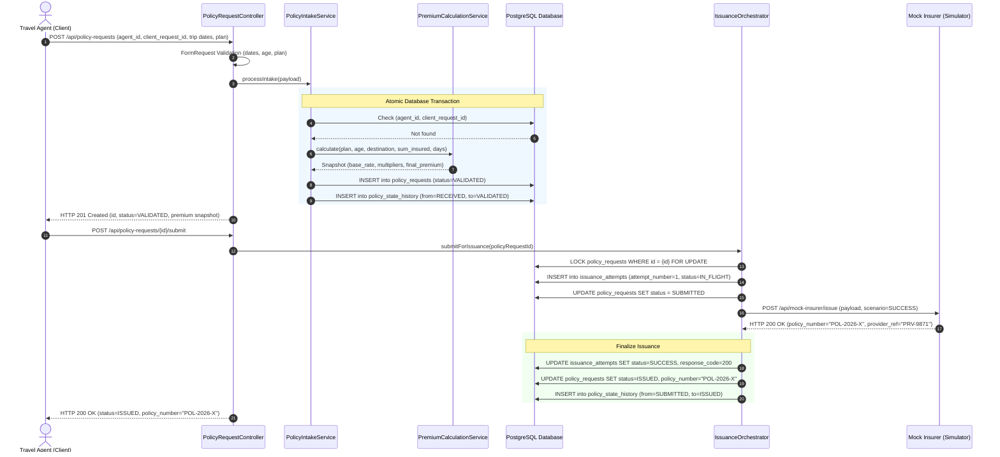
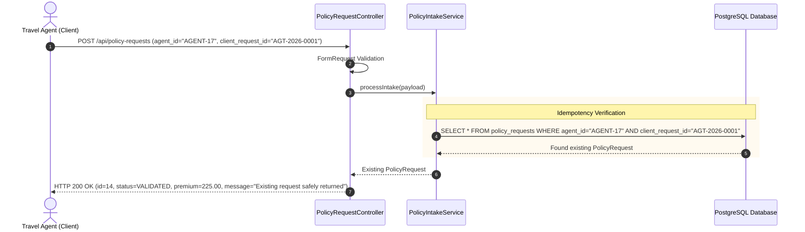
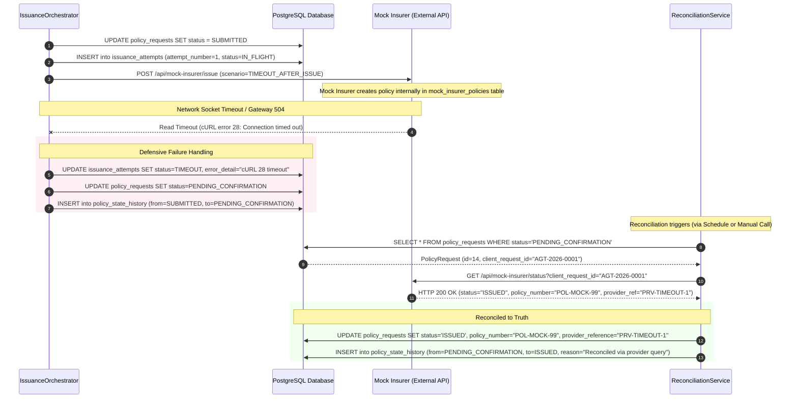
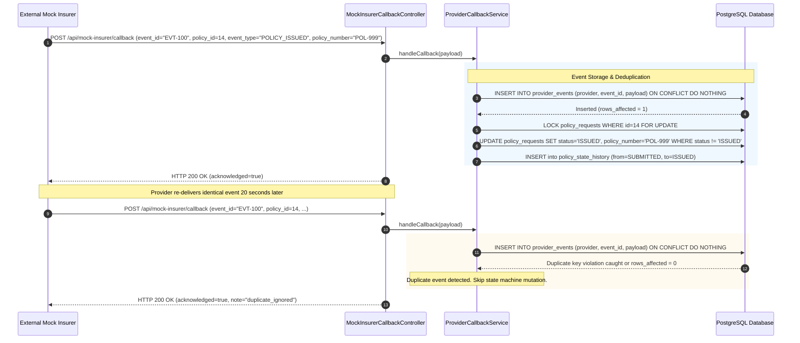
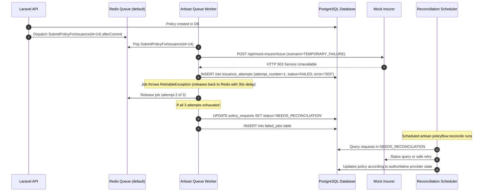

# Request Lifecycle & Sequence Diagrams

This document formalizes the runtime behavior of PolicyFlow across five critical lifecycle scenarios using Mermaid sequence diagrams.

---

## Scenario A: Successful Request Intake and Issuance

In this happy path, an agent submits a valid intake request. The system calculates the deterministic premium snapshot, saves the request, submits to the mock insurer, and receives immediate confirmation with a unique policy number.

---

## Scenario B: Duplicate Request Submission (Idempotent Intake)

When an agent retries an intake request (e.g., due to an initial client network disconnection or aggressive client retry) with identical `(agent_id, client_request_id)`, the system safely detects the record and returns HTTP 200 without creating duplicate records or recalculating pricing.

---

## Scenario C: Provider Timeout After Successful Issuance

A notorious distributed systems hazard: the client submits a policy to the insurer, the insurer successfully creates the policy internally, but the HTTP connection drops or times out before returning the response. **PolicyFlow avoids double issuance by never blindly reissuing.**

---

## Scenario D: Callback Delivery and Deduplication

When policies are processed asynchronously by the provider, the provider delivers events via webhooks. The callback endpoint logs the raw event and prevents duplicate processing if the provider sends the same event multiple times.

---

## Scenario E: Queue Job Failure and Reconciliation

Demonstrating resilient asynchronous execution when using Redis queues.

